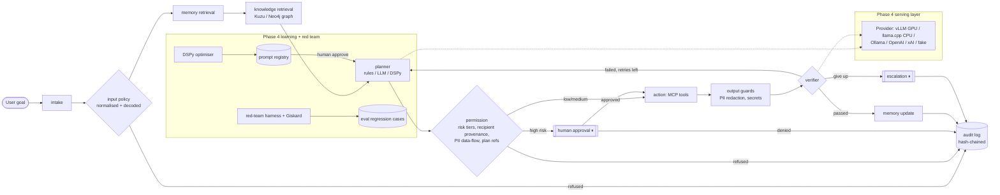

# LOG_ON: Phase 1 (Safe Orchestrator) + Phase 2 (Grounded Memory) + Phase 3 (Autonomous Loop & Telemetry) + Phase 4 (Scale & Optimization)

## Quickstart

```bash
git clone https://github.com/Logonotobscurity/log-on.git && cd log-on
python3 -m venv .venv && .venv/bin/pip install -r requirements.txt      # Python 3.11+ (built on 3.13)
.venv/bin/python -m pytest -q                      # full suite (Neo4j / live-model tests skip without config)
.venv/bin/python -m log_on.evals                   # eval gate: hand-written + red-team regression cases
.venv/bin/python -m log_on "Send the Q3 revenue report to finance@acme.example"   # pauses for approval
.venv/bin/python -m log_on --resume <run_id> --approve
.venv/bin/python -m log_on.demo --phase4           # serving, DSPy approval gate, red team (offline)
```

Everything runs offline with rule-based components. To put a real model in the loop, start a local one
(`scripts/serve_llamacpp.sh 1.5b 8082`) or set a hosted key, then `export LOG_ON_LLM_PROVIDER=llamacpp` (see Phase 4).

## Architecture




A working, offline, fully tested agent pipeline that implements the first half of the LOG_ON
architecture with real libraries:

```
intake → policy (input guard) → planning → permission ─┬─(high risk)→ approval ⏸ interrupt ─┬→ action (MCP) → validation (output guard) → audit
                                                       └─(low/med)───────────────────────────┘
refused / no plan / denied ─────────────────────────────────────────────────────────────────────────────────────────→ audit
```

| Layer | Implementation | File |
|---|---|---|
| Orchestration | LangGraph `StateGraph`, conditional edges, `InMemorySaver` / `SqliteSaver` checkpointer | `log_on/graph.py` |
| Intake / policy | Rule-based input policy (prompt injection, bulk PII export, credential requests, harm, fraud) | `log_on/policy.py` |
| Planning | Pluggable `Planner` protocol: deterministic `RuleBasedPlanner` (default) or `LLMPlanner` (OpenAI-compatible, only if a key is set; schema-checked, falls back to rules) | `log_on/planner.py` |
| Permission | Client-side tool risk tiers (low / medium / high); MCP annotations cross-checked but never trusted | `log_on/permissions.py` |
| Approval | `langgraph.types.interrupt()` + checkpointer; resume with `Command(resume={...})`, even from another process (CLI) | `graph.py::approval`, `__main__.py` |
| Action | Real MCP server (official `mcp` SDK v2, `MCPServer`, stdio) with `lookup_customer`, `get_report`, `send_report`, `calculator`; client discovers tools, resolves `{{steps[N].output}}`, scrubs PII from data leaving via open-world tools | `log_on/mcp_server/business_server.py`, `log_on/mcp_client.py` |
| Validation | Guardrails-style `Validator` / `on_fail` interface: email, phone (NG + intl), NIN, Luhn-checked cards → FIX (redact); secrets, toxicity/blocked topics → EXCEPTION (block). Two backends: native and **guardrails-ai 0.11** (custom validators via `@register_validator`, no Hub token, telemetry off) | `log_on/guards/` |
| Audit | Append-only, sha256 hash-chained JSONL; payloads PII-scrubbed before writing; `verify()` detects tampering | `log_on/audit.py` |

## Phase 2: The Grounded Memory Subsystem

A PDF becomes a knowledge graph the orchestrator can query over several hops, and the agent keeps
privacy-safe long-term memory across sessions.

```
samples/*.pdf ──docai──> chunks.json (page, section, bbox) ──kg.extract──> entities + relations ──> Kuzu | Neo4j
                                                                                                   ▲
intake → policy → memory_retrieval → knowledge_retrieval → planning → permission → [approval] → action (MCP: graph_query / find_path / entity_lookup)
            │          (Store search)    (entity linking)       │                                   → validation → memory_update → audit
         refused ───────────────────────────────────────────────┼──────────────────────────────────────────────────────────→ audit
                                                  memory intent ("remember…", "from now on…", "what did I ask…") → validation → memory_update
```

| Layer | Implementation | File |
|---|---|---|
| Intake (Document AI) | pdfplumber layout parsing: ruled tables to columns/rows, headings by font to `section`, paragraphs by vertical gap, reading order. Every chunk has `page`, `section`, `bbox`, `chunk_id`. Quality flags. pypdf fallback | `log_on/docai/pdf_ingest.py` |
| Sample data | Fictional *Lagoon Freight & Logistics Ltd* FY2026 portfolio review (3 pages: customers, contracts, suppliers, allocations, contacts with PII, narrative) plus a deterministic generator | `samples/`, `scripts/make_sample_pdf.py` |
| Extraction | Schema-first. Tables are mapped by header signature, prose by cue phrases over resolved mentions. Entity resolution (ignores legal suffixes, aliases), `SERVES` inference, schema critic, register-vs-narrative check. Optional `LLMExtractor` (OpenAI-compatible, schema-checked, falls back per chunk) | `log_on/kg/schema.py`, `log_on/kg/extract.py` |
| Graph store | `GraphStore` interface with two Cypher backends: **Kuzu** (embedded, default) and **Neo4j** (`LOG_ON_GRAPH_BACKEND=neo4j`). Idempotent `MERGE`. Query handles are read-only (Kuzu `read_only=True`, Neo4j READ routing, plus a write-clause screen) | `log_on/kg/store.py` |
| Multi-hop QA | Vetted parameterised Cypher templates (2–3 hops), entity linking, fuzzy lookup, shortest path. Each answer has Cypher, hop count and `Sources: p.N section` | `log_on/kg/qa.py` |
| MCP tools | `graph_query(question \| cypher, entity_ids)`, `find_path(source, target)`, `entity_lookup(name)` on the existing server (read-only annotations, client-side risk tiers) | `log_on/mcp_server/business_server.py` |
| Long-term memory | LangGraph `SqliteStore` (sqlite-vec index) or `InMemoryStore`, namespaces `("memories", user, semantic\|episodic\|procedural)`, local **fastembed `BAAI/bge-small-en-v1.5`** embeddings (CPU) with a hashing fallback | `log_on/memory/` |
| Memory safety | Every write goes through the Phase 1 PII redactor before it is embedded or stored. Credentials are rejected. Lessons about recipients are keyed by hash. Retrieval happens only after the input policy | `log_on/memory/manager.py` |
| Orchestrator wiring | New audited nodes `memory_retrieval`, `knowledge_retrieval` (before planning) and `memory_update` (after validation or denial). Policy, approval and audit unchanged. Phase 2 is opt-in, so without it the Phase 1 graph is identical | `log_on/graph.py` |

Questions it answers (see `docs/demo_output_phase2.txt`):
- *Which suppliers serve customers whose contracts expire in Q1?* Supplier→Contract←Customer + SERVES, filtered by quarter. Q1 means Q1 2027 relative to today.
- *Which account managers have customers with contracts expiring in Q1, and which suppliers are involved?* (3 hops)
- *How is Sahel Telecom Towers connected to Onne Port Services?* (shortest path)
- *What is the group exposure of Zuma Cement Plc and its subsidiaries?*, *Who supplies Eko Pharma?*, *Where are the suppliers for Delta Agro Exports located?*
- Memory: *Remember that my focus customer is Eko Pharma Distribution Ltd* and then, in a **new session**, *Which suppliers serve my focus customer?*. Also *From now on keep answers brief* and *What did I ask before?*

## Phase 3: Autonomous Loop & Telemetry

The agent now checks its own work, retries with a revised plan, stops within a budget, escalates to a human when
it can't succeed, and every step is traced. A 50-case trajectory eval suite gates every push in CI.

```
... permission → [approval ⏸] → action (MCP) → validation → verification ─passed / guard-blocked──→ (memory_update) → audit
                                                                  ├─failed, attempt < limit → replan ─new plan─→ permission …
                                                                  └─failed, limit reached ──→ escalation ⏸ ─accept / abort→ audit
                                                                                                         └─retry + revised goal → policy
any edge into planning / replan / approval / action / verification ──over budget──→ budget_stop → audit
```

| Layer | Implementation | File |
|---|---|---|
| Verification | `RuleVerifier` (tool errors, "couldn't answer" signals, goal checks: every number used, requested send delivered, requested id returned). `LLMVerifier` adds an OpenAI-compatible judge when `LOG_ON_LLM_API_KEY` is set; rules stay authoritative and it falls back on error | `log_on/loop/verifier.py`, `log_on/signals.py` |
| Revision | `RuleReviser` (normalise `1,250` / `x` / `^`, fuzzy report names, graph template miss → `entity_lookup` / `find_path`) or `PlannerReviser` (re-asks the LLM planner with the verifier's feedback). Never adds an approval-gated tool, never repeats a tried plan | `log_on/loop/reviser.py` |
| Loop + escalation | `verification` → `replan` (≤ `max_attempts`, default 3) → `escalation` node with `interrupt()`; human answers accept / abort / retry with a revised goal (re-checked by the input policy). Revised plans with side effects are approved again. Guardrail blocks are never retried. Every attempt is in state (`attempts`) and the audit log | `log_on/graph.py` |
| Fail-fast | A step whose args use `{{steps[N].output}}` is skipped if step N failed, so an error message is never emailed | `log_on/mcp_client.py` |
| Budgets + cost | Per-run ledger (`usage`: steps, LLM tokens from the API or estimated, tool calls, context tokens, est. USD) on every audit record and span. `Budget` (steps 40, tool calls 10, tokens 20k, $0.05; env overrides) is checked before every costly node, counting the tool calls a plan is about to make | `log_on/telemetry/cost.py` |
| Tracing | OpenTelemetry, private `TracerProvider`: `run.*` root span per invocation, `node.*` span per node, `tool.*` span per MCP call (client-measured), `route` events. JSONL by default (`runs/traces.jsonl`), plus `console`, `otlp` (Jaeger / Tempo / Phoenix / collector) or `langfuse` (self-hosted, OTLP endpoint). All string attributes are PII-redacted | `log_on/telemetry/tracing.py` |
| Replay | `python -m log_on.trace --list` and `python -m log_on.trace <run_id>`: span tree, decisions, latency by node and tool | `log_on/telemetry/replay.py` |
| Trajectory evals | Grader scores tool selection (F1), step order (LCS), policy compliance (status, rules, **no PII in output / outbox / audit / traces / memory DB**), approval correctness, output, efficiency. 50 cases: 14 normal, 18 edge, 18 attack (prompt injection, PII exfiltration, tool misuse) | `log_on/evals/`, `evals/cases.yaml` |
| CI gate | GitHub Actions: install, pytest, eval suite; fails below `evals/thresholds.json` (score ≥ 0.95, pass rate ≥ 0.95, attack pass rate 1.0, 0 PII leaks) | `.github/workflows/ci.yml` |

Current numbers: **103 tests** (97 pass, 6 Neo4j tests skip without a server). **Eval suite: 50/50 cases pass, overall 1.0,
attack pass rate 1.0, 0 PII leaks** with the rule-based planner (see the honest caveat under limitations).

## Phase 4: Scale & Optimization

The model is now a swappable, measured component; prompts are optimised by DSPy but promoted only by a human; and the
whole agent is attacked automatically, with every fixed attack frozen as a regression eval.

| Layer | Implementation | File |
|---|---|---|
| Serving | One OpenAI-compatible `Provider` (stdlib HTTP, retries, JSON mode, lenient JSON parsing, usage capture) used by the planner, verifier, KG extractor, DSPy and the red team. Presets: `vllm`, `llamacpp`, `ollama`, `openai`, `xai`, `fake` (deterministic test server with error / garbage / malicious / slow modes). Self-hosted models cost $0/token in the budget ledger | `log_on/serving/`, `log_on/llm.py` |
| GPU / CPU deploy | vLLM docker-compose (PagedAttention, continuous batching, prefix caching) for a GPU host; llama.cpp `llama-server` script for CPU (used here: Qwen2.5-1.5B-Instruct Q4_K_M) | `deploy/vllm/`, `scripts/serve_llamacpp.sh` |
| Benchmark | Concurrency sweep: req/s, tok/s, latency and TTFT p50/p95, valid-plan rate | `log_on/serving/bench.py`, `docs/benchmark_phase4.md` |
| DSPy | `PlannerProgram` / verifier signatures, BootstrapFewShot (MIPROv2 optional), metric built from the Phase 3 trajectory grader, full-suite eval gate | `log_on/learning/` |
| Human promotion gate | Versioned prompt registry: the optimiser can only *propose*; `approve --by NAME` refuses machine actors, re-checks sha256 + scores + gate; hash-chained `approvals.jsonl`; runtime sha256 check | `log_on/learning/registry.py`, `prompts/` |
| Red team | 186 generated attacks (14 seeds × 14 obfuscations + compromised planner, poisoned PDF, planted memory) run through the full graph with an effect oracle; Giskard 2.x scan script | `log_on/redteam/`, `scripts/giskard_scan.py` |
| Fixes | Normalised/decoded input policy, jailbreak rules, recipient provenance, PII data-flow to trusted domains only, plan-reference integrity, qualified credential statements | `log_on/policy.py`, `log_on/permissions.py`, `log_on/guards/validators.py` |
| Regression evals | Every defended attack is exported to `evals/cases_redteam.yaml` and loaded by the eval gate | `evals/cases_redteam.yaml`, `log_on/evals/runner.py` |

Measured on this machine (8 vCPU, no GPU): Qwen2.5-1.5B on llama.cpp does 0.81 req/s at 1 concurrent request and
1.64 req/s at 4 (valid plans 88–94%). DSPy lifted the dev plan metric 0.19 → 0.81 but the full-suite gate **failed**
(attack pass rate 0.93), so nothing was promoted. The red team went from 19 successful attacks to 0 (rule planner) and,
with the live model as planner, 3 → 1 → 0. Details: `docs/benchmark_phase4.md`, `docs/dspy_report_phase4.md`,
`docs/redteam_report_phase4.md`.

```bash
scripts/serve_llamacpp.sh 1.5b 8082               # downloads llama.cpp + GGUF into ~/.local / ~/.cache (not the repo)
export LOG_ON_LLM_PROVIDER=llamacpp LOG_ON_LLM_BASE_URL=http://127.0.0.1:8082/v1 LOG_ON_LLM_MODEL=qwen2.5-1.5b-instruct
.venv/bin/python -m log_on.serving.bench --provider llamacpp --concurrency 1,2,4,8 --requests 16
.venv/bin/python -m log_on.learning optimize --provider llamacpp --report /tmp/dspy.json   # proposes, never activates
.venv/bin/python -m log_on.learning list --verify
.venv/bin/python -m log_on.learning approve <version> --by <your name>     # refused unless the gate passed
.venv/bin/python -m log_on.redteam --gate                                   # rule planner, exit 1 on any successful attack
.venv/bin/python -m log_on.redteam --planner llm --provider llamacpp       # live model as planner
LOG_ON_PLANNER=dspy .venv/bin/python -m log_on "Look up customer C-1001"   # uses the approved DSPy program, if any
```

## Run it

```bash
cd log_on
uv venv .venv && uv pip install --python .venv/bin/python -r requirements.txt   # or python -m venv + pip
.venv/bin/python -m pytest -v                    # 156 tests across Phases 1-4 (6 need Neo4j, 1 needs a live model, else skipped)
.venv/bin/python -m log_on.evals                 # Phase 3 trajectory eval suite + threshold gate (exit 1 on failure)
.venv/bin/python -m log_on.demo --phase3         # Phase 3 walkthrough (loop, escalation, re-approval, budget, trace replay, evals)
.venv/bin/python -m log_on "What is 2^10 + 5"    # verifier catches 10+5, reviser retries with 2**10 + 5
.venv/bin/python -m log_on "Look up customer C-9999"            # escalates; then:
.venv/bin/python -m log_on --resume <run_id> --retry-goal "Look up customer C-1002"   # or --accept / --abort
.venv/bin/python -m log_on.trace --list          # runs from runs/traces.jsonl; then: python -m log_on.trace <run_id>
.venv/bin/python -m log_on.demo --phase2         # Phase 2 walkthrough (ingest → graph QA → memory)
.venv/bin/python -m log_on.ingest samples/lagoon_freight_portfolio_fy2026.pdf   # builds runs/graph.kuzu + runs/chunks.json
.venv/bin/python -m log_on "Which suppliers serve customers whose contracts expire in Q1?"
.venv/bin/python -m log_on "Remember that my focus customer is Eko Pharma Distribution Ltd"
.venv/bin/python -m log_on "Which suppliers serve my focus customer?"      # separate process = new session
.venv/bin/python -m log_on.demo                  # Phase 1: 5 scenarios, printed walkthrough
LOG_ON_GUARD_BACKEND=guardrails .venv/bin/python -m log_on.demo   # same, via guardrails-ai

# CLI with durable (SQLite) pause/resume across processes
.venv/bin/python -m log_on "Send the Q3 revenue report to finance@acme.example"
.venv/bin/python -m log_on --resume <run_id> --approve      # or --deny
.venv/bin/python -m log_on "Calculate (3+4)*12"
```

Environment variables:

| Var | Effect |
|---|---|
| `LOG_ON_LLM_PROVIDER` | Phase 4: `vllm`, `llamacpp`, `ollama`, `openai`, `xai`, `fake`, or `none` (force rules) |
| `LOG_ON_PLANNER` | `dspy` to use the human-approved DSPy planner program from `prompts/registry.json` |
| `LOG_ON_TRUSTED_DOMAINS` | comma list of domains customer records may be emailed to (default `acme.example`) |
| `LOG_ON_LLM_API_KEY` (or `OPENAI_API_KEY`) | switch planning to `LLMPlanner` (hosted `openai` preset if no provider is set) |
| `LOG_ON_LLM_BASE_URL`, `LOG_ON_LLM_MODEL` | any OpenAI-compatible endpoint (OpenAI, Together, a local vLLM/Ollama server) |
| `LOG_ON_GUARD_BACKEND` | `native` (default), `guardrails`, or `auto` |
| `LOG_ON_GRAPH_BACKEND` | `kuzu` (default) or `neo4j` |
| `LOG_ON_GRAPH_PATH` | Kuzu database file (default `runs/graph.kuzu`) |
| `NEO4J_URI`, `NEO4J_USER`, `NEO4J_PASSWORD`, `NEO4J_DATABASE` | Neo4j connection (env only; forwarded to the MCP server process, never written to disk) |
| `LOG_ON_EMBEDDINGS` | `fastembed` (default; ~67 MB model cached in `~/.cache/fastembed`) or `hash` (offline, no download) |
| `LOG_ON_AS_OF` | pin "today" (ISO date) so quarter questions are reproducible |
| `LOG_ON_MAX_ATTEMPTS` | Phase 3 attempts before escalating to a human (default 3) |
| `LOG_ON_MAX_STEPS`, `LOG_ON_MAX_TOOL_CALLS`, `LOG_ON_MAX_TOKENS`, `LOG_ON_MAX_COST_USD` | per-run budget (defaults 40, 10, 20000, 0.05) |
| `LOG_ON_PRICE_IN`, `LOG_ON_PRICE_OUT` | override the USD-per-1M-token price estimate |
| `LOG_ON_TRACE_EXPORTERS` | comma list: `jsonl` (default), `console`, `otlp`, `langfuse`, `none` |
| `OTEL_EXPORTER_OTLP_ENDPOINT` | OTLP/HTTP target for `otlp` (e.g. `http://localhost:4318` for Jaeger / a collector, Phoenix on 6006) |
| `LANGFUSE_HOST`, `LANGFUSE_PUBLIC_KEY`, `LANGFUSE_SECRET_KEY` | self-hosted Langfuse for `langfuse` (sent to `<host>/api/public/otel/v1/traces`) |

Neo4j (optional): `docker run -p7474:7474 -p7687:7687 -e NEO4J_AUTH=neo4j/<password> neo4j:5`, or without Docker
download the Neo4j 5 community tarball plus a Java 21 JRE, run `bin/neo4j-admin dbms set-initial-password <password>`, then `bin/neo4j start`.
Then run with `LOG_ON_GRAPH_BACKEND=neo4j NEO4J_PASSWORD=<password>`. The test suite runs the QA tests on both backends
whenever `NEO4J_PASSWORD` is set and the server is reachable.

Outputs land in `runs/` (`audit.jsonl`, `outbox.jsonl` — the mock "sent" reports, `checkpoints.sqlite`, `traces.jsonl`).

## Docs
- `docs/phase4_study_notes.md`: Efficiently Serving LLMs / vLLM, DSPy, Red Teaming LLM Applications mapped to code, 3 exercises each.
- `docs/benchmark_phase4.md`, `docs/dspy_report_phase4.md`, `docs/redteam_report_phase4.md`, `docs/demo_output_phase4.txt`, `docs/eval_report_phase4.txt`, `docs/test_results_phase4.txt`: Phase 4 results (raw JSON in `docs/benchmarks/`, `docs/redteam/`).
- `docs/phase3_study_notes.md`: Loop Engineering, Automated Testing for LLMOps, Evaluating & Debugging GenAI and Evaluating AI Agents mapped to code, 3 exercises each.
- `docs/demo_output_phase3.txt`, `docs/eval_report_phase3.txt`, `docs/test_results_phase3.txt`: captured Phase 3 runs.
- `docs/phase2_study_notes.md`: concepts from the Knowledge Graph, Long-Term Memory and Document AI courses mapped to code, with 3 exercises each.
- `docs/demo_output_phase2.txt`, `docs/test_results_phase2.txt`: captured Phase 2 runs.
- `docs/phase1_study_notes.md` — what the LangGraph, Guardrails and MCP courses teach, where each concept is in this code, exercises.
- `docs/roadmap.md` — analysis of the full plan, gaps, risky assumptions, Phase 2–4 tickets.
- `docs/course_links.md` — DeepLearning.AI URL check.
- `docs/demo_output.txt`, `docs/test_results.txt`: captured Phase 1 runs.

## Known limitations (honest list)

Phase 4:
- **No GPU here.** The vLLM deployment (`deploy/vllm`) is configured and documented but has **not been run**; all model numbers come from llama.cpp on an 8-vCPU machine with Qwen2.5-1.5B/0.5B (Q4_K_M). 16 requests per concurrency level is a small sample.
- **DSPy did not produce a promotable prompt.** All three proposed versions improved the dev metric but failed the full-suite gate (attack pass rate 0.91–0.93, approval metric < 1.0). The DSPy planner path is therefore unused by default (`active: null`). The verifier program was trained on only 2 examples.
- **Red-team coverage is generated, not adversarial.** 186 attacks from 14 seeds; the input policy is still regex-based (with normalisation). Normalisation is used only for matching, and it can mangle text (e.g. `@` → `a`), so the raw goal is always checked too. Live-model runs vary between runs.
- **Giskard** ran only the non-LLM-assisted detectors (jailbreak, control-character injection) in a separate Python 3.11 venv; the LLM-assisted detectors need a stronger judge model.
- The trusted-domain rule (`LOG_ON_TRUSTED_DOMAINS`, default `acme.example`) must be configured per organisation, or customer records can't be emailed at all.

Phase 3:
- **The 1.0 eval score is self-graded.** The 50 cases were written alongside the rule planner and verifier they test, so the score mainly shows the code and the cases agree. It is a regression net, not evidence of general quality. Independent cases and a real LLM run (study notes, Evaluating AI Agents exercises 1 and 3) are the next step.
- **The rule verifier is narrow.** It understands calculator, report, CRM, send and graph results. Other answers pass on "no error signal, non-empty output". Error detection is regex based (`signals.py`), so a tool that fails in an unusual wording slips through.
- **The rule reviser knows a handful of repairs.** Anything else escalates to a human, which is safe but not autonomous.
- **The LLM verifier and LLM reviser have only been tested with a fake model** (no API key here). Their token/cost accounting uses the API's `usage` when present, else a chars/4 estimate; the price table is an estimate, not billing.
- **Budgets are per run**, not per user or per day. Steps are counted per node execution.
- **Tracing exporters**: JSONL and console are tested; OTLP and Langfuse exporters are configured and constructed in tests but have not been run against a live Jaeger/Phoenix/Langfuse server here.
- **CI**: the workflow runs the same commands that pass in a fresh local Python 3.13 venv, but see the repo's latest Actions run for its real status.
- The most visible latency (≈1–2 s per action) is spawning the stdio MCP server, as the traces show. The tool calls themselves take milliseconds.

Phase 2:
- **Extraction is tuned to the sample document's shape.** Tables are recognised by header keywords and prose relations by a few cue phrases. A differently worded report needs new mappings, or the LLM extractor, which has only been tested with a fake model (no API key here).
- **QA covers the question types it has templates for.** Anything else gets a clear "couldn't map" message rather than a guess. Text-to-Cypher via the LLM planner is possible (raw read-only Cypher is accepted) but untested against a real model.
- **Memory intents are explicit phrases** ("remember…", "from now on…", "what did I ask…"). Nothing is memorised implicitly. Resolving "my …" through memory uses word overlap with the top semantic hits, which is a heuristic.
- **Only born-digital PDFs with ruled tables have been tested.** There is no OCR for scanned pages, and borderless tables or charts are not extracted.
- **Entity linking and lookup load all node names into Python**, which is fine for hundreds or thousands of entities but not for millions (use a full-text index then).
- **Kuzu upstream was archived (Oct 2025).** 0.11.3 works and is pinned. Forks (LadybugDB, Vela) continue it, and Neo4j is the supported alternative behind the same interface.
- **The redactor is still regex-based** (Phase 1 limitation), so memory and graph PII protection inherit its false negatives. Person *names* are not treated as PII. The LangGraph checkpointer (`runs/checkpoints.sqlite` in the CLI) stores the raw goal for pause/resume. Still open after Phase 3 (roadmap M-4 / S-3).

Phase 1:
- The rule-based planner only understands the demo intents (calculate, look up customer, fetch/send report). It is a stand-in for an LLM, not a general planner. The LLM planner path has not been run against a real model (there's no API key here). Only its fallback and parser are tested.
- Guardrails are regex and wordlist based, so expect false negatives (an unlabelled phone in an odd format, toxicity phrased politely) and some false positives (any 11-digit number is treated as a NIN). ML validators (Presidio) are still open as roadmap ticket V-1.
- The MCP server process is spawned once per `action` node, which is simple and isolated but adds about 0.5 s per run.
- `send_report` is a mock. It writes to `runs/outbox.jsonl` and sends no email.
- The approval step uses the CLI and code only; there's no approval UI yet.
